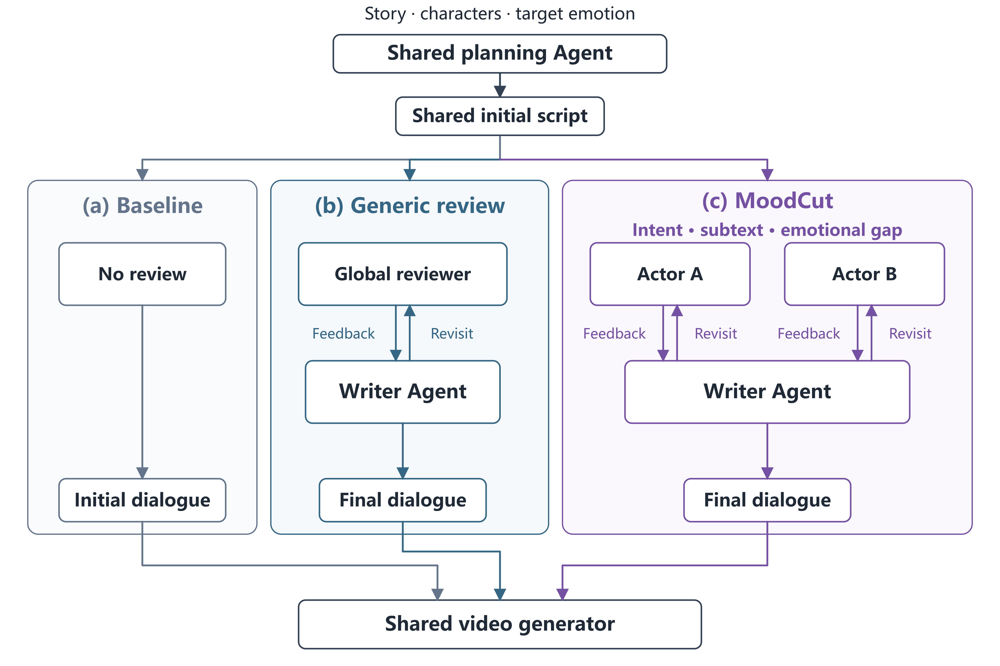

# MoodCut

**English** | [简体中文](README.zh-CN.md)

[](docs/images/moodcut-v4-en.svg)

**Let characters review dialogue against a target emotion, then let a shared screenwriter revise it.**

MoodCut is a DSA4213 course research project. Given a story, two character references and a target tone, it plans a shared scene and compares general script review with emotion-oriented Actor review. The research question is whether focused emotional feedback can help the resulting video convey the intended tone while keeping the story clear and the dialogue natural.

[Watch videos and compare dialogue](https://zhengads.github.io/MoodCut-dsa4213/) · [Quick start](#quick-start) · [Documentation](docs/README.md) · [Usage](docs/usage.md) · [Method](docs/ACTOR_REVIEW_METHOD.md) · [Development](#development)

## Method and comparison

The diagram and table describe the **v4 development protocol** used in the latest S01 case:

| Condition | Behavior |
| --- | --- |
| `baseline` | Keep the draft produced by the shared planning Agent, without review or revision. |
| `generic_review` | One global reviewer checks both characters' dialogue; a screenwriter Agent integrates the feedback. |
| `moodcut` | Two independent Actors inspect their own character's intent, subtext and emotional-expression gaps; the same screenwriter integrates their feedback. |

Both review conditions allow up to two revisions. Every candidate is revisited by the original reviewers. With no initial issues, the draft is retained; final disagreements remain recorded. Revision opportunities are matched, while call counts and costs may differ. API/contract errors, unknown charges and budget failures stop the flow.

In generated mode, **only dialogue may change**. Scene directions, actions, camera, character references, voices and generation settings remain common inputs. A fixed seed does not guarantee identical visuals after dialogue changes.

**V4 is available through explicit `review_protocol="actor_self_review_v4"` in generated-script orchestration.** The global/v1/v2/v3 protocols and default CLI behavior remain compatible. See [protocol selection and history](docs/ACTOR_REVIEW_METHOD.md) and the [actual S01 v4 record](docs/pilots/s01-v4-text-video.md).

## Current progress

As of 2026-10-25, the latest **S01 v4 video comparison** is available: [watch it](https://zhengads.github.io/MoodCut-dsa4213/#s01-v4) · [reviews, revisions, revisits and costs](docs/pilots/s01-v4-text-video.md). Generic review retained the draft; MoodCut changed one Kristoff line and revisited both Actors. Three condition entries correspond to two independently generated videos, with generic review reusing baseline. Successful text and video generation cost **$0.504356**. The gallery temporarily hides entries without completed videos; failure records and costs remain preserved.

The earlier S06 v3 development run produced three real videos for **$0.75421676**. [Watch them](https://zhengads.github.io/MoodCut-dsa4213/#s06-index) · [run record and original results](docs/pilots/s06-actor-v3-index.md)

These cases demonstrate technical execution. Spoken Chinese, character consistency, naturalness and emotional effects still require human inspection and independent evaluation. Successful and failed attempts remain in the [pilot records](docs/pilots/).

The candidate study inputs now comprise three complementary sets on the [same study page](docs/studies/six-story-clear-emotions-20261024/README.md). S01–S06 contain two stories each for affectionate, hostile and tense tones. S07–S12 contain one story for each VEMOCLAP class. S13–S18 add a second six-class set with deliberately understated authored drafts for exploratory review stress testing. These drafts are not natural model baselines, and the challenge set is not independent evidence of method superiority.

### Evaluation-set iteration

Evaluation work by 范旭阳 (FANXUYANG, GitHub: fanx9905-blip). The evaluation sets changed in four steps; the full record with per-video numbers is the [emotion evaluation record](docs/studies/emotion-evaluation-20261027/EMOTION_EVALUATION_RECORD.md).

1. **S01–S06, three tones.** VEMOCLAP outputs six emotions and has no affectionate or tense class, so mapping rules were tried: V0 (name match), V1 (skip videos with surprise ≥ 50%), V2 (frozen group sums) and a proposed V3 (conflict gate). **V1 and V2 are historical and no longer used for scoring.** V2 matched 20 of 29 videos (affectionate 9/9, hostile 11/12, tense 0/8), and tense and hostile overlap in the six probabilities. The V2 code stays in `src/moodcut/vemoclap_atmosphere.py` only to reproduce those numbers.
2. **S07–S12, six emotions (current approach).** One scenario per VEMOCLAP emotion; videos are scored on the six probabilities directly, with no merging into tones. First results over 13 unique videos: anger and disgust are recognised, sadness only in the moodcut condition, joy is indistinguishable from surprise, fear is not detected.
3. **S13–S18, review-challenge set.** All six stories are evaluated: only S13 (anger) is recognised in all three conditions, the other 15 videos are not; the result follows the character pair more than the script.
4. **Fear diagnostics.** Per-modality ablation, feature swaps with a real horror clip and a brightness control on S09/S15 show that the visual features decide the result; fear rises only when the picture is made very dark, which does not show that the video conveys fear.

All numbers are exploratory: one video per condition and no human ratings. Human blind rating remains the primary evidence (draft protocol in the study folder). **Analysis results are in [`docs/studies/emotion-evaluation-20261027/results/`](docs/studies/emotion-evaluation-20261027/results/).**

### S07–S12: VEMOCLAP basic-emotion scenarios

S07–S12 reuse the six existing character pairs while changing the plots and target labels. They extend the study rather than replacing or relabelling S01–S06.

| ID | Scenario | Characters | Target emotion |
| --- | --- | --- | --- |
| S07 | Another broken promise | Maxime, Valentina | anger |
| S08 | The foul-smelling medicine | Lijing, Taiyi | disgust |
| S09 | Something in the forest | Elsa, Mattias | fear |
| S10 | The celebration is saved | Anna, Kristoff | joy |
| S11 | An irreplaceable keepsake | Lucy, Gru | sadness |
| S12 | An unexpectedly finished task | Nezha, Aobing | surprise |

The [full S01–S18 specification](docs/studies/six-story-clear-emotions-20261024/README.md) defines each relationship, fixed plot, dialogue task, boundaries, asset reuse, experimental controls and VEMOCLAP evaluation scope. S07–S12 include generated-mode scene inputs, reused asset manifests, a hash-bound index and an offline 18-assignment evaluation configuration. No videos, model outputs or evaluation results are included in those committed inputs.

### S13–S18: review-challenge drafts

| ID | Target emotion | Characters | Understated draft focus |
| --- | --- | --- | --- |
| S13 | anger | Lucy, Gru | A unilateral decision is challenged without explicit anger |
| S14 | disgust | Anna, Kristoff | A spoiled smell is described too mildly |
| S15 | fear | Nezha, Aobing | Danger is noted without reciprocal fear |
| S16 | joy | Lijing, Taiyi | Good news is delivered without shared happiness |
| S17 | sadness | Elsa, Mattias | A meaningful loss receives a minimal response |
| S18 | surprise | Maxime, Valentina | Early completion receives only a mild question |

The [S13–S18 section](docs/studies/six-story-clear-emotions-20261024/README.md#s13s18-authored-review-challenge-scenarios) includes the exact mixed-language drafts and safeguards. S15–S16 use Mandarin; the other four use English. It is an eight-second exploratory development set. The programmatic generated-script pipeline can bind one saved authored draft to the shared initial plan before the three-condition split; paid execution still requires separate model, scope and budget authorization.

## Quick start

Requires **Python 3.11+**. Run from the repository root; the examples use PowerShell on Windows:

```powershell
git clone https://github.com/zhengads/MoodCut-dsa4213.git
cd MoodCut-dsa4213
python -m venv .venv
.venv/Scripts/python -m pip install -e ".[dev]"
.venv/Scripts/python -m moodcut smoke --mock --output runs/smoke-01
```

On Linux/macOS, replace `.venv/Scripts/python` with `.venv/bin/python`.

`smoke` checks the three-condition JSON flow without network access, API keys or video rendering. Use a new output directory for each run.

### Render an offline preview

Install **FFmpeg and ffprobe** on PATH and a Chinese font, such as Microsoft YaHei on Windows or Noto Sans CJK on Linux. Then run:

```powershell
.venv/Scripts/python -m moodcut run --mock --scene tests/fixtures/scene.json --assets tests/fixtures/assets.json --output runs/demo-01
.venv/Scripts/python scripts/compare_demo.py --run runs/demo-01
Start-Process (Resolve-Path runs/demo-01/comparison.html).Path
```

The output contains a shared draft, three condition records and three static animatics. These software fixtures validate the pipeline, not the method's effectiveness. Select a font with `--font` or `MOODCUT_FONT` if needed.

### Choose an entry point

| Task | Entry point and scope |
| --- | --- |
| Check the text flow | `smoke --mock`: offline JSON, without video. |
| Preview still images and subtitles | `run --mock`: the default animatic flow. |
| Prepare video requests from saved generated scripts | `run --output-mode generated --source-block ...`: compile requests only. |
| Execute prepared video requests | `execute-generated`: offline by default; real calls need an explicit model, scope and budget. |
| Inspect saved videos, export anonymized media or import ratings | [Usage guide](docs/usage.md#检查与评价生成视频). |

**Default `plan/review/smoke/run` commands still use the original animatic flow and do not enable Actor v3/v4 automatically.** Select a protocol explicitly during generated-script orchestration. Script preparation, request compilation and video generation are separate stages. See the [generated-video workflow](docs/usage.md#生成式视频流程) for parameters and prerequisites.

## Using the evaluation sets

The evaluation sets are committed as generated-mode (schema 1.1) inputs under `docs/studies/six-story-clear-emotions-20261024/inputs/`. They do not run through the offline animatic demo above: `run --mock` with an S07 scene fails with an invalid animatic `schema_version`, and `--output-mode generated` needs a saved `--source-block` from prepared scripts. They connect to the generated-video workflow and to the `evaluate` command instead.

| Set | Scene inputs | Index | Assignment config |
| --- | --- | --- | --- |
| S01–S06 (three tones) | `inputs/s01_…` to `s06_…` | `inputs/index.json` | none; only the development example `configs/experiment.json` |
| S07–S12 (six emotions) | `inputs/s07_…` to `s12_…` | `inputs/basic-emotions-index.json` | `configs/basic-emotions-experiment.json` |
| S13–S18 (review challenge) | `inputs/s13_…` to `s18_…`, with `draft-dialogue.json` | `inputs/basic-emotion-challenge-index.json` | `configs/basic-emotions-challenge-experiment.json` |

1. **Check the assignments offline** (no network, no paid calls): `.venv/Scripts/python -m moodcut evaluate --config configs/basic-emotions-experiment.json --dry-run` lists 18 planned runs; the challenge config does the same.
2. **Prepare scripts and video requests** with the [generated-video workflow](docs/usage.md#生成式视频流程). Real generation needs an explicit model, scope and budget, and the character images from the [asset library](assets/library/README.md), which are not committed.
3. **Score the videos you have**, one `<video_id>.mp4` each:
   - one video: `scripts/run_vemoclap.ps1` or `python -m moodcut.vemoclap` ([VEMOCLAP guide](docs/vemoclap.md));
   - batch with per-modality ablation: `scripts/emotion_eval/run_vemoclap_batch.py`, then `collect_results.py` ([script guide](scripts/emotion_eval/README.md));
   - VBench imaging_quality: `scripts/emotion_eval/make_vbench_manifest.py` and `run_vbench_batch.sh` ([VBench guide](docs/vbench.md));
   - human rating: `evaluate --blind-output` and `--ratings`, with the six emotion labels plus `uncertain` ([evaluation guide](docs/evaluation.md)).
4. **Without any model**: `python scripts/emotion_eval/analyze_mapping.py` and `python -m unittest discover -s tests -p "test_emotion_eval_results.py"` reproduce the mapping analysis and check the committed results.

VEMOCLAP and VBench scoring are separate scripts, not subcommands of `python -m moodcut`; they read finished `.mp4` files and do not use the `--mock` flow of this Quick start.

## Documentation

| Topic | Reference |
| --- | --- |
| Commands, outputs, API configuration and assets | [Usage](docs/usage.md) |
| Actor review, writer revisions and protocol versions | [Method](docs/ACTOR_REVIEW_METHOD.md) |
| Data structures, interfaces, shared identity and accounting | [Contracts](docs/CONTRACTS.md) |
| Static rendering, request compilation and video inspection | [Rendering](docs/rendering.md) |
| Anonymized export, human ratings, coverage and cost summaries | [Evaluation](docs/evaluation.md) |
| Emotion evaluation record: rule iteration, ablations, per-video results | [Emotion evaluation record](docs/studies/emotion-evaluation-20261027/EMOTION_EVALUATION_RECORD.md) · [results](docs/studies/emotion-evaluation-20261027/results/) |
| Character references, sources and license status | [Animation asset library](assets/library/README.md) |
| Settings, results and failures from previous trials | [Pilot records](docs/pilots/) |
| Module ownership, task cards and branch rules | [Team workflow](docs/TEAM.md) · [Branch rules](docs/BRANCHES.md) |

## Development

Read [AGENTS.md](AGENTS.md) and the [team workflow](.agents/skills/moodcut-team/SKILL.md), check Issues and existing PRs, and claim only unfinished increments. The shared startup instructions are in [developing a task with AI](docs/usage.md#用-ai-开发一个任务).

```powershell
git config commit.template .gitmessage
.venv/Scripts/python -m pytest -q
.venv/Scripts/python scripts/prepare_references.py --check
```

Video tests require FFmpeg/ffprobe and a usable font; set `MOODCUT_TEST_FONT` when needed. If the reference cache is missing, follow the [reference preparation guide](docs/REFERENCES.md). Ordinary tests and CI do not call paid models.

```text
src/moodcut/         Core modules; prompts/ holds model prompts
configs/            Model, rendering and experiment configuration
tests/              Offline tests and fixtures/
scripts/            Asset preparation, video inspection and comparison
                    scripts/emotion_eval/ holds the VEMOCLAP/VBench evaluation scripts
docs/               Methods, contracts, tasks and pilot records
assets/             Asset metadata; original images stay in ignored folders
references/         Source locks, reading index and local caches
runs/               Local run outputs, excluded from Git
```

## References and reuse

MoodCut draws on **MovieAgent** for staged planning and asset organization, and **FilmAgent** for review–revision–recheck collaboration. These are independent adaptations to this project's contracts, not complete reproductions of either paper.

Pinned versions, reading paths and citations are listed in [References](docs/REFERENCES.md) and [references.bib](references/references.bib); the adopted scope is recorded in [Reuse notes](docs/upstream-reuse.md). Attribution and provider acceptance do not establish permission to use or redistribute character images. Original images are not committed to Git.
