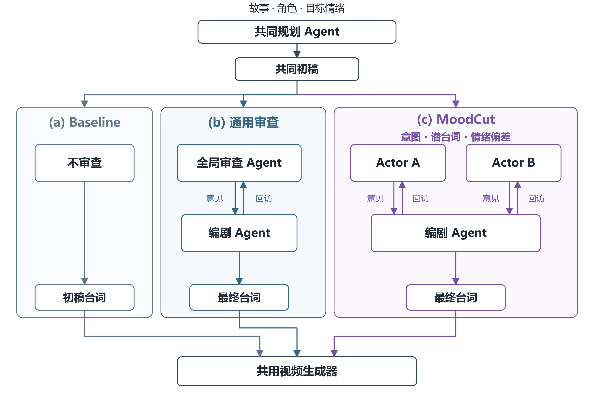

# MoodCut

[English](README.md) | **简体中文**

[](docs/images/moodcut-v4-zh.svg)

**让角色围绕目标情绪审查台词，再由编剧统一修订。**

MoodCut 是 DSA4213 课程研究项目：给定故事、两个角色参考图和目标氛围，共同规划分镜，再比较通用审查与情绪导向审查。研究问题是：情绪专项反馈能否让成片更准确地传达目标氛围，同时保持剧情清楚、表达自然？

[观看视频与台词对比](https://zhengads.github.io/MoodCut-dsa4213/) · [快速开始](#快速开始) · [文档索引](docs/README.md) · [使用指南](docs/usage.md) · [方法说明](docs/ACTOR_REVIEW_METHOD.md) · [开发协作](#开发协作)

## 方法与三组对照

上图及下表对应最新 S01 使用的 **v4 开发协议**：

| 条件 | 处理方式 |
| --- | --- |
| `baseline` | 保留共同规划 Agent 生成的初稿，不审查、不修订 |
| `generic_review` | 1 个全局审查 Agent 检查双方台词，再由编剧 Agent 统一修订 |
| `moodcut` | 2 个独立 Actor 检查各自角色的意图、潜台词与情绪表达偏差，再由同一编剧统一修订 |

两个审查条件均最多修改两次，每个候选稿均由原审查者回访；没有初始意见则保留初稿，最终分歧保留。修改机会相同，调用次数与费用不保证相同。接口错误、未知费用或预算失败则停止流程。

生成模式下，**各组只改台词**；场景、动作、镜头、角色参考、声音及生成设置保持共同输入。固定 seed 不保证不同台词生成的画面完全一致。

**v4 已可在生成式脚本编排中通过 `review_protocol="actor_self_review_v4"` 显式选择。** global/v1/v2/v3 协议及默认 CLI 行为保持兼容。选择方法与历史版本见[方法说明](docs/ACTOR_REVIEW_METHOD.md)，v4 的实际运行证据见 [S01 记录](docs/pilots/s01-v4-text-video.md)。

## 当前进展

截至 2026-10-25，最新 **S01 v4 视频对照**已上线：[直接观看](https://zhengads.github.io/MoodCut-dsa4213/#s01-v4) · [审查、修改、回访与费用记录](docs/pilots/s01-v4-text-video.md)。通用审查保留初稿；MoodCut 修改克里斯托夫一句并回访两位 Actor。三个条件入口对应两段独立生成视频，通用审查复用 baseline；成功文本与视频合计 **$0.504356**。页面暂时隐藏未出片条目，失败记录与费用仍保留。

此前 S06 v3 开发试跑已生成三段真实视频，总费用 **$0.75421676**。[直接观看](https://zhengads.github.io/MoodCut-dsa4213/#s06-index) · [试跑记录与原始结果](docs/pilots/s06-actor-v3-index.md)

这证明了该样例的技术流程跑通；中文对白、人物一致性、自然度和情绪效果仍待人工检查与独立评价。历史成功和失败均保留在[试跑记录](docs/pilots/)中。

后续候选输入为[六个明显情绪情景 v2](docs/studies/six-story-clear-emotions-20261024/README.md)：affectionate、hostile、tense 各两个故事。它们是待执行的研究输入，范围确认不等于付费运行或正式评价已获批准。

### 评测集的迭代

评测工作：范旭阳（FANXUYANG，GitHub：fanx9905-blip）。评测集经历了四步，含逐视频数值的完整记录见[情绪评测研究记录](docs/studies/emotion-evaluation-20261027/EMOTION_EVALUATION_RECORD.md)。

1. **S01–S06，三种氛围。** VEMOCLAP 只输出六种情绪，没有“亲密”“紧张”，因此尝试过几套对应规则：V0（按名字对应）、V1（surprise ≥ 50% 的视频弃判）、V2（事先冻结的分组求和）以及提议中的 V3（冲突闸门）。**V1 和 V2 已是历史方案，不再用于打分。** V2 在 29 条视频里对 20 条（亲密 9/9，敌对 11/12，紧张 0/8），紧张和敌对在六类概率上重叠。V2 的代码保留在 `src/moodcut/vemoclap_atmosphere.py`，只用于复现这些数字。
2. **S07–S12，六种情绪（现行做法）。** 每种 VEMOCLAP 情绪一个情景，直接看六类概率，不再合并成氛围。13 条不重复视频的初步结果：愤怒和厌恶可识别，悲伤只有 moodcut 条件命中，喜悦和惊讶分不开，恐惧识别不出来。
3. **S13–S18，审查挑战集。** 六个故事都已评测：只有 S13（愤怒）三个条件都被识别，其余 15 条视频都没有；结果更像由角色对决定，而不是由剧本决定。
4. **恐惧专项排查。** 对 S09、S15 做逐路消融、用真实恐怖片段的特征互换和亮度对照，结果表明决定性的是视觉特征；只有画面被压得很暗时 fear 才升高，这不等于视频传达了恐惧。

所有数字都是探索性的：每个条件一个视频，没有人工评分。人工盲评仍是主要证据（方案草案在研究记录目录中）。**实验分析结果在 [`docs/studies/emotion-evaluation-20261027/results/`](docs/studies/emotion-evaluation-20261027/results/)。**

## 快速开始

需要 **Python 3.11+**。以下命令从仓库根目录运行，Windows 使用 PowerShell：

```powershell
git clone https://github.com/zhengads/MoodCut-dsa4213.git
cd MoodCut-dsa4213
python -m venv .venv
.venv/Scripts/python -m pip install -e ".[dev]"
.venv/Scripts/python -m moodcut smoke --mock --output runs/smoke-01
```

Linux/macOS 将 `.venv/Scripts/python` 换成 `.venv/bin/python`。

`smoke` 检查三条件的 JSON 流程，不联网、不需要 API key，也不渲染视频。输出目录必须是新目录；再次运行时换一个名称。

### 生成离线预览视频

先将 **FFmpeg、ffprobe** 加入 PATH，并安装中文字体（Windows 微软雅黑或 Linux Noto Sans CJK）。随后运行：

```powershell
.venv/Scripts/python -m moodcut run --mock --scene tests/fixtures/scene.json --assets tests/fixtures/assets.json --output runs/demo-01
.venv/Scripts/python scripts/compare_demo.py --run runs/demo-01
Start-Process (Resolve-Path runs/demo-01/comparison.html).Path
```

输出包含共同初稿、三组记录和三段静态 animatic。它使用软件夹具检查流程，不能用于比较方法效果。字体问题可通过 `--font` 或 `MOODCUT_FONT` 指定字体文件。

### 选择正确的入口

| 你要做什么 | 入口与边界 |
| --- | --- |
| 检查文本流程 | `smoke --mock`：离线 JSON，无视频 |
| 查看固定图片和字幕预览 | `run --mock`：默认 animatic |
| 从已有生成式脚本准备视频请求 | `run --output-mode generated --source-block ...`：只编译请求 |
| 执行已准备的视频请求 | `execute-generated`：默认离线；真实调用需明确模型、规模和预算 |
| 检查已有视频、匿名导出、汇总人工评分 | [使用指南](docs/usage.md#检查与评价生成视频) |

**默认 `plan/review/smoke/run` 仍使用原 animatic 流程，不自动启用演员 v3/v4。** 需要在生成式脚本编排时显式选择协议；准备脚本、编译请求、生成视频是三个阶段。参数和前置条件见[生成式视频流程](docs/usage.md#生成式视频流程)。

## 使用评测集

评测集以生成式（schema 1.1）输入的形式提交在 `docs/studies/six-story-clear-emotions-20261024/inputs/` 下。它们不能走上面的离线 animatic 演示：用 S07 的 scene 运行 `run --mock` 会因 animatic 的 `schema_version` 不符而失败，`--output-mode generated` 也需要已保存的 `--source-block`。它们接入的是生成式视频流程和 `evaluate` 命令。

| 评测集 | 场景输入 | 索引 | 分配配置 |
| --- | --- | --- | --- |
| S01–S06（三种氛围） | `inputs/s01_…` 至 `s06_…` | `inputs/index.json` | 无；只有开发示例 `configs/experiment.json` |
| S07–S12（六种情绪） | `inputs/s07_…` 至 `s12_…` | `inputs/basic-emotions-index.json` | `configs/basic-emotions-experiment.json` |
| S13–S18（审查挑战） | `inputs/s13_…` 至 `s18_…`，含 `draft-dialogue.json` | `inputs/basic-emotion-challenge-index.json` | `configs/basic-emotions-challenge-experiment.json` |

1. **离线检查分配**（不联网、不产生费用）：`.venv/Scripts/python -m moodcut evaluate --config configs/basic-emotions-experiment.json --dry-run` 会列出 18 次计划运行；挑战集配置同理。
2. **准备脚本和视频请求**：按[生成式视频流程](docs/usage.md#生成式视频流程)。真实生成需要明确模型、范围、预算，并需要[动画素材库](assets/library/README.md)中的角色图片（未提交）。
3. **给已有视频打分**，每个视频命名为 `<video_id>.mp4`：
   - 单个视频：`scripts/run_vemoclap.ps1` 或 `python -m moodcut.vemoclap`（[VEMOCLAP 说明](docs/vemoclap.md)）；
   - 批量并做逐路消融：`scripts/emotion_eval/run_vemoclap_batch.py`，再运行 `collect_results.py`（[脚本说明](scripts/emotion_eval/README.md)）；
   - VBench imaging_quality：`scripts/emotion_eval/make_vbench_manifest.py` 和 `run_vbench_batch.sh`（[VBench 说明](docs/vbench.md)）；
   - 人工评分：`evaluate --blind-output` 和 `--ratings`，使用六种情绪标签加 `uncertain`（[评价说明](docs/evaluation.md)）。
4. **不需要任何模型**：`python scripts/emotion_eval/analyze_mapping.py` 和 `python -m unittest discover -s tests -p "test_emotion_eval_results.py"` 可以复现映射分析并检查已提交的结果。

VEMOCLAP 和 VBench 打分是独立脚本，不是 `python -m moodcut` 的子命令；它们读取已生成的 `.mp4`，不使用本快速开始里的 `--mock` 流程。

## 文档导航

| 内容 | 文档 |
| --- | --- |
| 命令、输出结构、API 配置、素材准备 | [使用指南](docs/usage.md) |
| 演员自审、编剧修订与版本差异 | [方法说明](docs/ACTOR_REVIEW_METHOD.md) |
| 数据结构、接口、共享身份与账目 | [公共契约](docs/CONTRACTS.md) |
| 静态渲染、请求编译与视频检查 | [渲染说明](docs/rendering.md) |
| 匿名导出、人工评分、覆盖率与费用统计 | [评价说明](docs/evaluation.md) |
| 情绪评测记录：规则迭代、消融实验、逐视频结果 | [情绪评测研究记录](docs/studies/emotion-evaluation-20261027/EMOTION_EVALUATION_RECORD.md) · [结果](docs/studies/emotion-evaluation-20261027/results/) |
| 角色参考图、来源与许可状态 | [动画素材库](assets/library/README.md) |
| 历次试跑的设置、结果与失败 | [试跑记录](docs/pilots/) |
| 模块分工、任务卡与分支规则 | [团队协作](docs/TEAM.md) · [分支规则](docs/BRANCHES.md) |

## 开发协作

先阅读 [AGENTS.md](AGENTS.md) 和[团队工作流](.agents/skills/moodcut-team/SKILL.md)，核对 Issue 与已有 PR，只认领未完成的增量。统一开工指令见[用 AI 开发一个任务](docs/usage.md#用-ai-开发一个任务)。

```powershell
git config commit.template .gitmessage
.venv/Scripts/python -m pytest -q
.venv/Scripts/python scripts/prepare_references.py --check
```

视频测试依赖 FFmpeg/ffprobe 与可用字体，可用 `MOODCUT_TEST_FONT` 指定。参考缓存缺失时按[资料准备说明](docs/REFERENCES.md)处理。普通测试和 CI 不调用付费模型。

```text
src/moodcut/         核心模块；prompts/ 集中存放提示词
configs/            模型、渲染与实验配置
tests/              离线测试与 fixtures/
scripts/            素材准备、视频检查和对比工具
docs/               方法、接口、任务与试跑记录
assets/             素材元数据；原图保存在忽略目录
references/         来源锁定清单、阅读索引与本地缓存
runs/               本地运行输出，不提交
```

## 参考与复用

MoodCut 参考 **MovieAgent** 的分阶段规划与素材组织，以及 **FilmAgent** 的审查—修订—复查方法，采用符合本项目契约的独立适配，不是两篇论文的完整复现。

固定版本、阅读路径与引用见[参考资料](docs/REFERENCES.md)及 [references.bib](references/references.bib)；具体采用范围见[复用说明](docs/upstream-reuse.md)。角色图片的署名与提供商接受均不等于取得使用或再分发许可，原始图片不提交到 Git。
